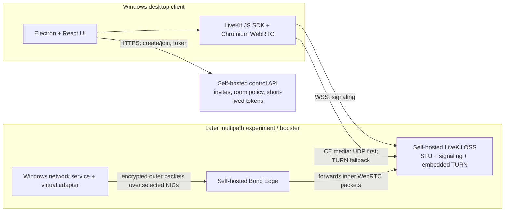

# Plexocall: Windows-first calling app

**Status:** Approved for implementation (user approval: 2026-10-23 IST)  
**Date:** 2026-10-23 (IST)  
**Scope:** Windows desktop client first; own calling app first; later booster for other Windows apps  
**Cost rule:** No paid calling, TURN, analytics, auth, or AI APIs. Self-host open-source services. Existing server hardware is preferred.

## Decision

Build the calling product on Electron/React and the LiveKit JavaScript SDK, with a self-hosted LiveKit open-source SFU and a small self-hosted control API. Use WebRTC for capture, codecs, ICE connectivity, DTLS-SRTP transport, congestion control, and media. The stable call mode starts with standard ICE path selection and network-change recovery, plus useful per-call network diagnostics. A private, opt-in multipath experiment can be evaluated alongside it without making unproven transport part of the dependable call path.

Do **not** make custom multipath packet bonding a release dependency yet. In parallel, run a bounded Windows tunnel experiment using `mqvpn` as a research candidate. Keep that mode separate and private while it is being evaluated; do not ship or bundle it until license, security, Windows lifecycle, and interoperability reviews pass. If it proves safe, interoperable with the selected call stack, and improves measured call quality, design a production-owned Windows transport and self-hosted bonding edge. Do not promise zero loss or seamless failover before measurements.

This is the best viable cost/functionality tradeoff found: it gives a real call app and group-call architecture without requiring us to write a WebRTC media stack. It intentionally means the first app release does not combine Wi-Fi and tether bandwidth simultaneously. Self-hosting avoids vendor API bills; it cannot eliminate the need for a reachable machine, public network connectivity, bandwidth, and operations for calls between arbitrary internet users.

## User goals and constraints

- Make a Windows calling app for audio and video; calling is the primary product.
- Build the app before a system-wide booster for WhatsApp, Instagram, Zoom, Meet, or other apps.
- Keep the design suitable for later multi-network transport and a Windows booster.
- Prefer existing open-source components or project-owned code; no paid cloud media/API dependency.
- Treat the screenshot and pasted text as ideas to evaluate. Their `0% loss`, `0ms gap`, and “stateless relay” claims are not product requirements or validated performance results.
- The target folder was empty and its Git discovery resolved to a profile-level parent repository. This folder now has its own Git repository so all project work stays isolated here.

## Architecture

### Windows client

- Reuse Plexo's Electron/React application shell, build configuration, settings conventions, adapter discovery, and reviewed UI primitives where they fit. Keep renderer privilege narrow and use the existing preload/IPC pattern only after security review.
- Replace the download screens, download state, transfer manager, torrent stack, and extension/browser bridge with calling features.
- Use the LiveKit browser JavaScript SDK inside the Electron renderer. The JS SDK supports Windows desktop browsers; Electron-specific device permissions, audio playback, camera selection, screen capture, packaging, and updates still require implementation validation.
- Keep the renderer unprivileged. Do not run the full Electron app as Administrator.
- In the first release, show the selected media path and available call-quality measurements: round-trip time, jitter, packet loss, send/receive bitrate, reconnect state, and relevant WebRTC stats. Display unknown/unavailable values honestly.

### Self-hosted call services

- Use [LiveKit OSS](https://github.com/livekit/livekit) as the room signaling and SFU layer. SFU routing gives a consistent topology for one-to-one and group calls and avoids building our own media router. It also means media bandwidth passes through the server, so deployment capacity depends on actual participant count, resolution, and call time.
- Add a small project-owned control API for invite/room policy and short-lived LiveKit participant tokens. The API does not carry media. Use a simple self-hosted data store; no external identity or analytics provider is required for the invite-based alpha.
- Run development services locally with container tooling. For an internet pilot, deploy the services to a machine the project owner controls. [LiveKit's deployment guide](https://docs.livekit.io/transport/self-hosting/deployment/) calls for a public endpoint, trusted TLS, and opened media ports; its embedded TURN can reduce separate TURN-service work. Its [port and firewall needs](https://docs.livekit.io/transport/self-hosting/ports-firewall/) must be documented in the deployment configuration.
- The desktop client is Windows-only. Linux containers are the recommended host deployment for the SFU. An existing Windows machine may be used for local development with Linux containers, but public production reachability depends on the host's network and firewall.

### Privacy and security

- WebRTC transport encryption is required. LiveKit also provides client-side media/data E2EE, but [key generation, secure distribution, rotation, and participant removal](https://docs.livekit.io/transport/encryption/) are app responsibilities.
- Before any public multi-tenant beta, implement and review an E2EE key lifecycle. A candidate design is client-generated room keys carried only in an invite URL fragment; the control API must never receive or log the media key. Room removal/rotation behavior must be defined before claiming E2EE.
- Until E2EE key management is complete, describe the self-hosted server as a trusted media service and do not claim that the server cannot access media.
- Use short-lived, room-scoped participant tokens, expiring invitations, host admission controls, and rate limits. Avoid recording, transcription, AI processing, or persistent media storage in V1.
- Persist room expiry/revocation as durable state, serialize token issuance against revocation, and repeat SFU room closure through a three-minute grace period (two-minute token lifetime plus a one-minute margin) before finalizing—even after service restarts. Encrypt creator capabilities and unresolved create idempotency keys locally so managed rooms can be recovered or ended after restarting the desktop app.
- Collect only operational call metrics needed for diagnostics. No third-party telemetry endpoint is enabled by default.

### Future Windows bonding layer

If the feasibility gate passes, the target is a narrow Rust or C++ Windows service plus a TUN-style virtual adapter and self-hosted Bond Edge. The service would route only the calling app's required destinations through the overlay first. It would send encrypted outer packets over per-interface sockets and let the edge forward inner WebRTC packets to the SFU. A [Windows Filtering Platform app selector](https://learn.microsoft.com/en-us/windows/win32/fwp/application-layer-enforcement--ale-) belongs to the later booster phase, not the first call-app release.

Wintun and `mqvpn` are candidates for investigation, not approved dependencies. Confirm licenses, binary redistribution terms, security posture, driver installation/signing, crash cleanup, Windows updates, route rollback, NAT behavior, MTU, and packet scheduling before adoption. The app must remain usable with the bonding service absent or disabled.

## Capability scope

### V1 calling app

- Windows desktop installation and update path.
- Invite-based rooms, with audio and video calls, including group rooms through the SFU.
- Camera and microphone selection, mute/camera controls, participant list, leave/rejoin, and screen sharing.
- Network and device diagnostics with call quality stats and clear reconnect state.
- Self-hostable control API and media server; documented local development and owner-hosted deployment.
- Standard ICE connectivity and TURN fallback as configured by the owner-hosted service.
- Optional private-alpha multipath experiment only after the separate lab gate; normal calling must continue to work when it is absent or disabled.
- No dependency on paid vendor APIs.

### Deliberately later

- Simultaneous active Wi-Fi + tether media bonding in production.
- Routing third-party app traffic, including WhatsApp, Instagram, Zoom, and Meet.
- iOS, Android, macOS, and Linux desktop clients.
- Persistent social graph, phone-number identity, PSTN, recording, transcription, AI, and paid multi-region hosting.

## Research findings that drive the decision

### WebRTC and multipath

ICE gathers/checks candidate pairs, then selects a pair for a component ([RFC 8445](https://www.rfc-editor.org/rfc/rfc8445.html)). The [standard WebRTC API](https://www.w3.org/TR/webrtc/#dom-rtcicetransport-getselectedcandidatepair) reports the selected pair; it does not define a general multipath scheduler. This supports path selection, diagnostics, and recovery, not simultaneous packet duplication or striping across Wi-Fi and tether. Windows `IP_UNICAST_IF`/`IPV6_UNICAST_IF` chooses an interface for a socket the application controls ([IPv4](https://learn.microsoft.com/en-us/windows/win32/winsock/ipproto-ip-socket-options), [IPv6](https://learn.microsoft.com/en-us/windows/win32/WinSock/ipproto-ipv6-socket-options)); it does not transparently change Chromium's WebRTC media sockets.

Multipath QUIC is close to standardization but, as of 2026-10-23, its [IETF draft](https://datatracker.ietf.org/doc/draft-ietf-quic-multipath/) is still in the RFC Editor queue and leaves path/address management and concurrent traffic scheduling to the application. [MPTCP](https://www.rfc-editor.org/rfc/rfc8684.html) is a TCP byte-stream protocol, not a direct transport for WebRTC's RTP/SRTP media. The older [Multipath RTP draft](https://datatracker.ietf.org/doc/draft-ietf-avtcore-mprtp/) is expired. Microsoft's [MsQuic multipath work](https://github.com/microsoft/msquic/pull/4724) remains experimental/incomplete; [Tencent TQUIC](https://github.com/Tencent/tquic) exposes experimental multipath behavior with compatibility and failed-path concerns. None is a mature, interoperable Windows WebRTC bonding solution found in this review.

`mqvpn` is a useful lab candidate because its [project and README](https://github.com/mp0rta/mqvpn) describe a Windows client, Linux server, and multipath tunnel that can carry IP traffic. Its own documentation calls for validating operational safety and production suitability. Treat it as a way to learn and measure, not a product dependency.

### Self-hosted call stack options

| Option | Strength | Why it is not the V1 choice |
|---|---|---|
| Browser WebRTC P2P only | Low media-server bandwidth in successful 1:1 direct calls ([WebRTC peer connections](https://webrtc.org/getting-started/peer-connections)) | The app must own signaling, user/room policy, and TURN operations; group mesh multiplies each sender's upload. |
| LiveKit OSS | Integrated room signaling, SFU, JavaScript client SDK, and embedded TURN ([server](https://github.com/livekit/livekit), [deployment](https://docs.livekit.io/transport/self-hosting/deployment/)) | Chosen. The operator still supplies reachable infrastructure and bandwidth. |
| mediasoup | Flexible Node/C++ SFU media layer ([docs](https://mediasoup.org/documentation/v3/)) | Signaling and much of the room/application lifecycle remain project responsibilities. |
| Janus | General-purpose WebRTC gateway with plugins ([docs](https://janus.conf.meetecho.com/docs/)) | More gateway/plugin integration work; Windows is not its recommended server target. |
| Pion | Go WebRTC toolkit with useful transport-level building blocks ([project](https://github.com/pion/webrtc)) | A toolkit, not a complete room product; we'd own more SFU, signaling, and operational behavior. |

### Cost reality

There is no paid API requirement in this design. Local development and LAN calls can run on existing hardware. Internet calls between arbitrary networks need reachable signaling/media services; restrictive NAT/firewalls may require a relay ([RFC 8656 TURN](https://www.rfc-editor.org/rfc/rfc8656.html)). A self-hosted SFU/TURN/Bond Edge still consumes compute, public IP capacity, and bandwidth. If the project has no reachable host, zero-cost global service cannot be guaranteed. This is an infrastructure constraint, not something a socket addon can remove.

## Plexo reuse and licensing plan

Plexo is [MIT-licensed](https://github.com/anmolkapil/plexo/blob/2ffd68177f5296916c6591660a1751c1e9eca90a/LICENSE) at the reviewed commit. Preserve the upstream license and copyright notices for copied files, and inventory all dependency licenses before shipping.

**Likely adaptation candidates:** Electron bootstrap/build, preload/IPC shape, settings persistence, [network interface discovery](https://github.com/anmolkapil/plexo/blob/2ffd68177f5296916c6591660a1751c1e9eca90a/src/main/network/interfaces.ts), logging conventions, and reviewed UI primitives.

**Rewrite/remove from the product path:** download orchestration ([download manager](https://github.com/anmolkapil/plexo/blob/2ffd68177f5296916c6591660a1751c1e9eca90a/src/main/download/downloadManager.ts)), HTTP transfer stages, torrent transfer and peer code, file staging, download-specific state, and the browser extension/bridge. Plexo's existing [`deviceBinding.ts`](https://github.com/anmolkapil/plexo/blob/2ffd68177f5296916c6591660a1751c1e9eca90a/src/main/network/deviceBinding.ts) is Linux-specific and binds TCP; it is not a Windows UDP media transport. The pasted “35% reuse” number is not a measured code audit.

## Delivery sequence and gates

1. **Project baseline:** keep this folder as its own repository; retain Plexo attribution/license for any copied code; document dependency and build provenance.
2. **Calling vertical slice:** Windows app joins a self-hosted LiveKit room, publishes/subscribes audio/video, handles device selection, group participants, screen share, leave/rejoin, and displays truthful WebRTC stats.
3. **Owner-hosted operations:** local compose setup, secure token issuance, invitation expiry/admission, TLS/media-port deployment guide, health checks, and resource/traffic visibility. No paid vendor services.
4. **Privacy gate:** design and review E2EE key exchange/rotation before public multi-tenant beta; do not label server-terminated media as E2EE.
5. **Multipath feasibility lab:** compare normal ICE against a tunnel experiment under controlled Wi-Fi/tether loss, jitter, reordering, MTU, and interface-failure scenarios. Record p50/p95 latency/jitter, loss before/after recovery, setup success, reconnect time, CPU, bytes per path, and leakage/route cleanup. Set launch thresholds from baseline measurements instead of inventing “zero loss” targets.
6. **Production bonding decision:** only after the lab passes security, NAT, Windows install/uninstall, route rollback, interoperability, and QoE gates should we choose between adopting a vetted tunnel base and building a project-owned transport/edge.
7. **Booster:** separately design targeted app routing through Windows Filtering Platform; validate each supported app/version/call mode. Do not advertise universal compatibility.

## Main risks and unresolved implementation details

- No public host, domain, or port-forwarding capability has been confirmed. The design can be developed locally, but public call reachability depends on this.
- WebRTC stats and network-change recovery behavior must be validated in the exact Electron/Chromium and LiveKit SDK versions selected at implementation time.
- Group E2EE key lifecycle, especially member removal and key rotation, needs a concrete design before public beta.
- Relay and SFU capacity/cost estimates require target room sizes, resolution, concurrency, and measured media bitrates.
- Driver distribution and signing, Wintun licensing, and third-party tunnel code licenses require review before any bundled Windows service.
- “Flawless”, “0% loss”, and “0ms gap” are not acceptance claims. Real paths can fail together or deliver packets after playout deadlines.

## Sources

### Plexo source review (pinned commit)

- [Plexo README](https://github.com/anmolkapil/plexo/blob/2ffd68177f5296916c6591660a1751c1e9eca90a/README.md)
- [Plexo MIT license](https://github.com/anmolkapil/plexo/blob/2ffd68177f5296916c6591660a1751c1e9eca90a/LICENSE)
- [Adapter discovery](https://github.com/anmolkapil/plexo/blob/2ffd68177f5296916c6591660a1751c1e9eca90a/src/main/network/interfaces.ts)
- [Linux TCP device binding](https://github.com/anmolkapil/plexo/blob/2ffd68177f5296916c6591660a1751c1e9eca90a/src/main/network/deviceBinding.ts)
- [Download route implementation](https://github.com/anmolkapil/plexo/blob/2ffd68177f5296916c6591660a1751c1e9eca90a/src/main/network/routes.ts)
- [Download manager](https://github.com/anmolkapil/plexo/blob/2ffd68177f5296916c6591660a1751c1e9eca90a/src/main/download/downloadManager.ts)

### WebRTC, NAT, and transport standards

- [RFC 8445: ICE](https://www.rfc-editor.org/rfc/rfc8445.html)
- [W3C WebRTC API: selected candidate pair](https://www.w3.org/TR/webrtc/#dom-rtcicetransport-getselectedcandidatepair)
- [RFC 8835: Transports for WebRTC](https://www.rfc-editor.org/rfc/rfc8835.html)
- [RFC 8834: WebRTC RTP media](https://www.rfc-editor.org/rfc/rfc8834.html)
- [RFC 8836: Congestion control requirements](https://www.rfc-editor.org/rfc/rfc8836.html)
- [RFC 8656: TURN](https://www.rfc-editor.org/rfc/rfc8656.html)
- [RFC 8684: Multipath TCP](https://www.rfc-editor.org/rfc/rfc8684.html)
- [IETF Multipath QUIC draft status](https://datatracker.ietf.org/doc/draft-ietf-quic-multipath/)
- [IETF archived Multipath RTP draft](https://datatracker.ietf.org/doc/draft-ietf-avtcore-mprtp/)
- [MsQuic multipath discussion](https://github.com/microsoft/msquic/discussions/4890) and [experimental pull request](https://github.com/microsoft/msquic/pull/4724)
- [Tencent TQUIC](https://github.com/Tencent/tquic), [multipath discussion](https://github.com/Tencent/tquic/discussions/379), and [failed-path issue](https://github.com/tencent/tquic/issues/518)
- [mqvpn project](https://github.com/mp0rta/mqvpn) and [platform/deployment README](https://github.com/mp0rta/mqvpn/blob/main/README.md)

### Windows networking and security

- [Microsoft IPv4 socket options](https://learn.microsoft.com/en-us/windows/win32/winsock/ipproto-ip-socket-options)
- [Microsoft IPv6 socket options](https://learn.microsoft.com/en-us/windows/win32/WinSock/ipproto-ipv6-socket-options)
- [Microsoft WFP Application Layer Enforcement](https://learn.microsoft.com/en-us/windows/win32/fwp/application-layer-enforcement--ale-)
- [Microsoft named-pipe security](https://learn.microsoft.com/en-us/windows/win32/ipc/named-pipe-security-and-access-rights)
- [Wintun upstream repository](https://github.com/WireGuard/wintun) and [official site](https://www.wintun.net/)

### Call stack, hosting, and E2EE

- [LiveKit server and license](https://github.com/livekit/livekit)
- [LiveKit JavaScript client SDK](https://github.com/livekit/client-sdk-js)
- [LiveKit self-host deployment](https://docs.livekit.io/transport/self-hosting/deployment/)
- [LiveKit ports and firewall](https://docs.livekit.io/transport/self-hosting/ports-firewall/)
- [LiveKit E2EE and key distribution](https://docs.livekit.io/transport/encryption/)
- [RFC 3986 URI fragment component](https://www.rfc-editor.org/rfc/rfc3986.html#section-3.5)
- [mediasoup documentation](https://mediasoup.org/documentation/v3/)
- [Janus documentation](https://janus.conf.meetecho.com/docs/)
- [Pion WebRTC](https://github.com/pion/webrtc)
- [WebRTC peer-connection guide](https://webrtc.org/getting-started/peer-connections)
- [WebRTC TURN guide](https://webrtc.org/getting-started/turn-server)

## Research method

Reviewed the Plexo repository at commit `2ffd68177f5296916c6591660a1751c1e9eca90a`; compared WebRTC, SFU, NAT traversal, Windows socket/virtual-interface, and multipath options; prioritized standards, Microsoft documentation, and official project sources. The multipath maturity conclusion is based on the public standards/repository state checked on 2026-10-23 and should be rechecked before implementation.
